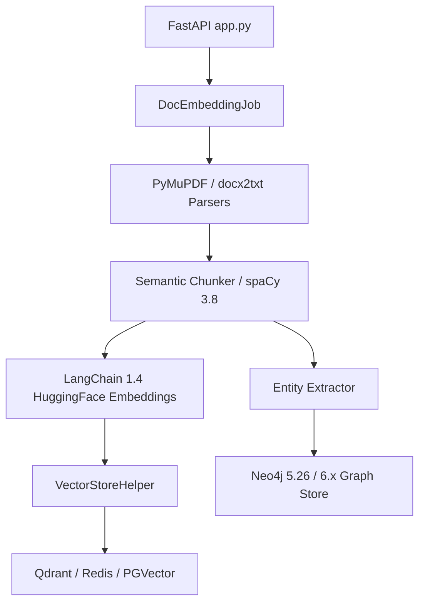

# Technical Design: Document Preprocessing Modernization

## Architecture & Component Interaction
The preprocessing engine handles incoming documents, converts them to chunks, generates embeddings, and writes graph entities:

## Interface Contracts & Schemas
Documents are transformed into standard `Document` objects with metadata:
- `page_content`: string
- `metadata`: `{ source, page, chunk_id, hash }`

## Vector Store & Lazy Loading Strategy
- `VectorStoreHelper` uses lazy conditional imports for PGVector to avoid hard runtime dependency on unpinned community packages.
- Direct dependencies (`langchain-text-splitters`, `pydantic`, `qdrant-client`) are explicitly declared.
- Bounded driver ranges (`pymupdf>=1.25.0,<3`, `neo4j>=5.26.0,<7`, `spacy>=3.8.4,<4`) ensure stability against unverified major upgrades.

## External API Integration & Resilience
- **LangChain Embeddings**: Batch embedding generation with rate limit handling and local caching.
- **Neo4j Driver**: Connection pooling and transactional chunk writes verified across driver versions.

## Security & Operational NFRs
- Sanitization of uploaded file paths and extensions.
- Processing throughput target: >= 20 pages per second for text extraction.
- Runtime Python environment: `>=3.11`.
