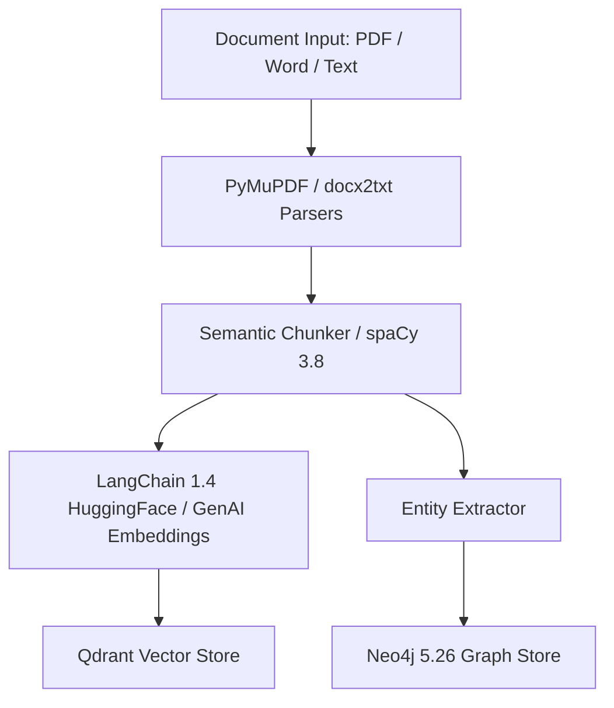

# Technical Design: Document Preprocessing Modernization

## Architecture & Component Interaction
The preprocessing engine handles incoming documents, converts them to chunks, generates embeddings, and writes graph entities:

## Interface Contracts & Schemas
Documents are transformed into standard `Document` objects with metadata:
- `page_content`: string
- `metadata`: `{ source, page, chunk_id, hash }`

## External API Integration & Resilience
- **LangChain Embeddings**: Batch embedding generation with rate limit handling and retry logic.
- **Neo4j Driver**: Connection pooling and transactional chunk writes.

## Security & Operational NFRs
- Sanitization of uploaded file paths and extensions.
- Processing throughput target: >= 20 pages per second for text extraction.

